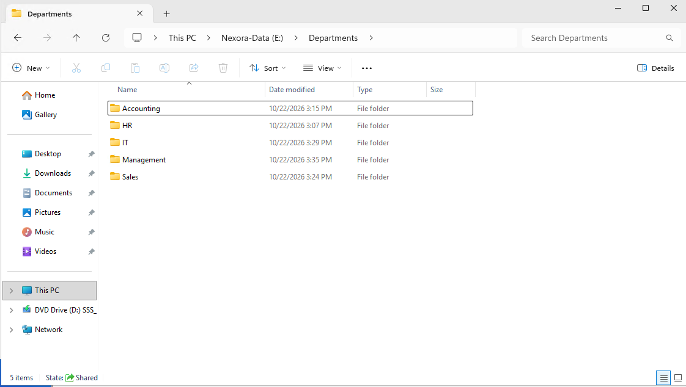
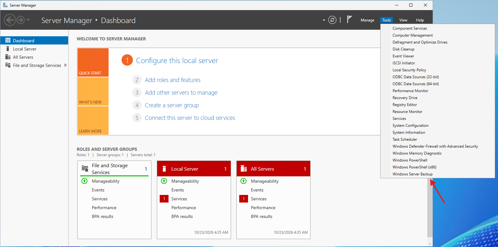

# Lab 02 - Windows Server Backup Installation

## Objective
Install and verify the Windows Server Backup feature on FILE01, a domain-joined Windows Server 2025 file server in the Nexora Technologies homelab.

This lab establishes the backup software required to protect departmental data and perform future recovery exercises.

## Lab Environment
| Component | Configuration |
| :--- | :--- |
| Server | FILE01 |
| Operating System | Windows Server 2025 |
| Domain | ad.nexora.test |
| IP Address | 10.77.10.30 |
| Virtualization Platform | Microsoft Hyper-V |
| Server Role | Departmental File Server |
| Backup Software | Windows Server Backup |

## 1. Preparing FILE01
Started FILE01 in Hyper-V and signed in using an authorized domain Administrator account.

Verified that the server was operational and that the existing departmental directory was available:

These departmental folders will be protected using Windows Server Backup in the following labs.

## 2. Installing Windows Server Backup
Used Server Manager to install the Windows Server Backup feature.

#### Installation Steps
1. Opened Server Manager.
2. Selected Manage -> Add Roles and Features.
3. Chose Role-based or feature-based installation.
4. Selected FILE01 as the destination server.
5. Left the existing server roles unchanged.
6. On the Features page, selected Windows Server Backup.
7. Continued through the wizard and clicked Install.
8. Confirmed that the installation completed successfully.

Windows Server Backup was installed without changing FILE01's existing file sharing configuration.

## 3. Verifying the Installation
After completing the installation, I opened:
- Server Manager -> Tools

Confirmed that Windows Server Backup appeared in the available administrative tools.

## 4. Understanding Windows Server Backup
Windows Server Backup is a Windows Server feature used to create backup of files, folders, volumes, and supported system components.

It provides administrative tools for configuring backup schedules, performing one-time backups, reviewing backup results, and recovering protected data.

For this project, Windows Server Backup will initially protect the departmental files stored on FILE01.
Future labs will cover system-state protection and disaster recovery procedures for DC01.

## 5. Backup Planning
The initial FILE01 backup configuration will use the following approach:

| Setting | Planned Configuration |
| :--- | :--- |
| Backup source | E:\Departments |
| Backup type | Custom selection |
| Backup destination | Dedicated 100 GB virtual disk |
| Backup frequency | Daily |
| Scheduled time | 11:00 PM |
| Recovery verification | Restore a deleted test file |

The backup destination will be configured separately from FILE01's existing operating system and departmental data volumes.

## 6. Lessons Learned
This lab provides practical experience with:
- Installing Windows Server features through Server Manager.
- Understanding the role of Windows Server Backup.
- Preparing a domain-joined file server for data protection.
- Verifying feature installation before configuration.
- Planning backup requirements before creating backup jobs.
