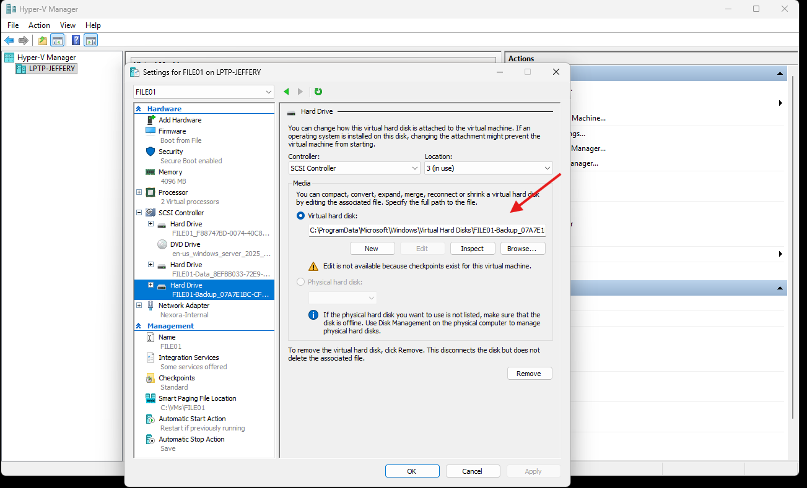
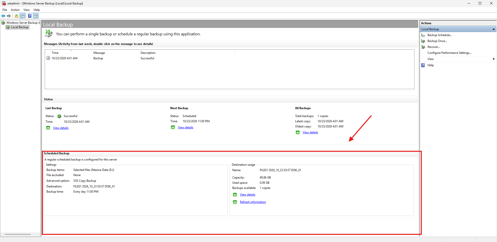
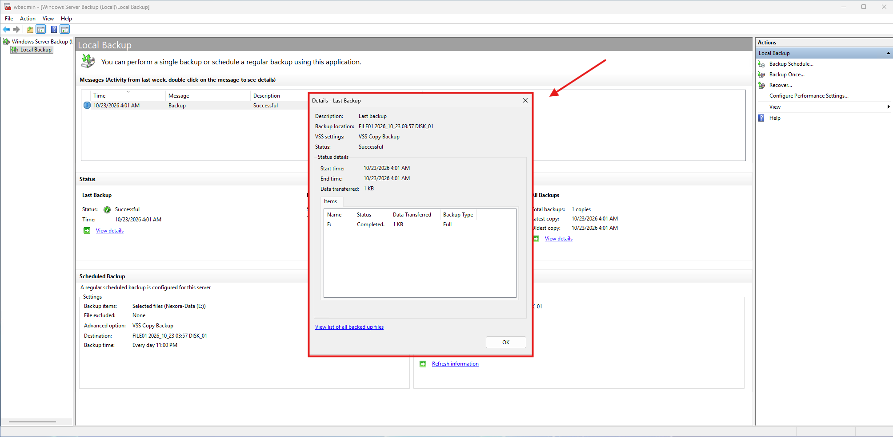

# Lab 03 - FILE01 Backup Storage and Configuration

## Objective
Configure dedicated backup storage for FILE01, create a scheduled departmental file backup using Windows Server Backup, and verify successful backup execution.

This lab builds on the Windows Server Backup installation completed in Lab 02.

## Lab Environment
| Component | Configuration |
| :--- | :--- |
| Server | FILE01 |
| Operating System | Windows Server 2025 |
| Domain | ad.nexora.test |
| Server IP Address | 10.77.10.30 |
| Virtualization Platform | Microsoft Hyper-V |
| Backup Software | Windows Server Backup |
| Backup Source | E:\Departments |
| Backup Destination | Dedicated 100 GB virtual disk |

## 1. Configuring Dedicated Backup Storage
Created a new virtual hard disk using Hyper-V Manager to serve as the dedicated backup destination for FILE01.

### Virtual Hard Disk Configuration
| Setting | Value |
| :--- | :--- |
| Virtual Hard Disk Name | FILE01-Backup.vhdx |
| Disk Format | VHDX |
| Disk Type | Dynamically Expanding |
| Maximum Capacity | 100 GB |
| Controller | SCSI Controller |
| Purpose | Dedicated Backup Storage |

### Configuration Steps
1. Opened Hyper-V Manager on the physical host
2. Shut down FILE01.
3. Launched the New Virtual Hard Disk Wizard.
4. Selected the VHDX disk format.
5. Selected Dynamically Expanding.
6. Named the disk FILE01-Backup.vhdx.
7. Configured a maximum capacity of 100 GB.
8. Attached the virtual disk to FILE01 through its SCSI Controller.
9. Started FILE01.
10. Initialized the new disk using GPT in Windows Disk Management.

The disk was initially left unallocated so Windows Server Backup could prepare it as a dedicated backup destination.

## 2. Selecting the Backup Source
Opened Windows Server Backup on FILE01 and launched the Backup Schedule Wizard.
Selected the Custom backup configuration to protect only the departmental files instead of the entire server.
Selected E:\Departments as the backup source.

This includes the 5 departmental folders and their contents.

## 3. Configuring the Scheduled Backup
Configured a daily backup schedule through Windows Server Backup.

### Backup Schedule Settings
| Setting | Configuration |
| :--- | :--- |
| Backup Configuration | Custom |
| Backup Source | E:\Departments |
| Frequency | Once Daily |
| Scheduled Time | 11:00 PM |
| Backup Destination Type | Dedicated Backup Disk |
| Destination Capacity | 100 GB |

### Backup Destination Configuration
Selected Back up to a hard disk that is dedicated for backups.
Used the Show All Available Disks option to locate the new 100 GB disk.

Selected only the dedicated backup disk, ensuring that the operating system and departmental data disks were not selected.
Windows Server Backup prepared the new disk for exclusive backup use.

**Note**: Scheduled backups require FILE01 to be running at the scheduled time. A powered-off virtual machine cannot execute its backup schedule.

## 4. Performing the Initial Manual Backup
Instead of waiting for the scheduled backup, I performed an initial backup manually.

### Backup Procedure
1. Opened Windows Server Backup.
2. Selected Local Backup -> Backup Once.
3. Chose Scheduled backup options.
4. Verified that E:\Departments was selected.
5. Confirmed the dedicated backup disk as the destination.
6. Started the backup.
7. Monitored the operation until completion.

### Backup Result
Windows Server Backup reported that the backup operation completed.
Reviewed the backup status in the Local Backup console to confirm successful execution.

## 5. Backup Storage Considerations
The dedicated backup disk is separate from FILE01's operating system and departmental data virtual disks.
However, all disks reside on the same physical Hyper-V host.

This configuration provides logical separation and supports recovery testing, but it does not protect against failure of the physical host or its storage device.

A production backup strategy should include independent backup storage, offline or offsite copies, appropriate access controls, and periodic recovery testing.

## 6. Lessons Learned
This lab provides practical experience with:
- Creating dynamically expanding VHDX files in Hyper-V.
- Attaching additional storage to Windows Server virtual machines.
- Initializing virtual disks using GPT.
- Selecting custom backup sources.
- Configuring dedicated Windows Server Backup destinations.
- Scheduling automatic backups.
- Performing manual backups.
- Monitoring and verifying backup job completion.
- Understanding the limitations of backups stored on the same physical host.
