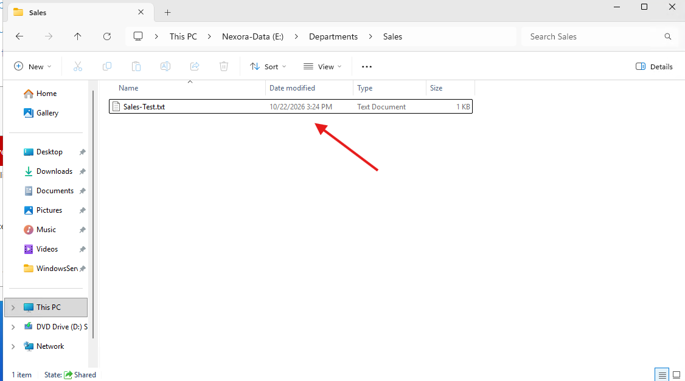
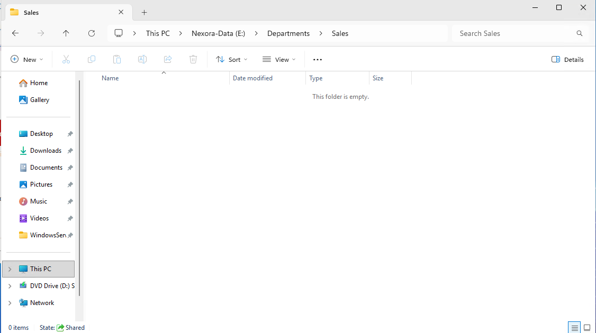

# Lab 04 - File Backup and Recovery Testing

## Objective
Simulate an accidental file deletion on FILE01 and recover the deleted file using Windows Server Backup.

This lab verifies that the backup configured in Lab 03 contains recoverable data and demonstrates a practical file-level disaster recovery procedure.

## Lab Environment
| Component | Configuration |
| :--- | :--- |
| Server | FILE01 |
| Operating System | Windows Server 2025 |
| Domain | ad.nexora.test |
| IP Address | 10.77.10.30 |
| Virtualization Platform | Microsoft Hyper-V |
| Backup Software | Windows Server Backup |
| Protected Directory | E:\Departments |
| Test File | E:\Departments\Sales\Sales-Test.txt |
| Backup Destination | Dedicated 100 GB virtual disk |

## 1. Recovery Scenario
In this exercise, a departmental file was deliberately deleted to simulate data loss.

**Scenario:** A Sales employee accidentally deletes an important file from the departmental directory. The IT Administrator must recover the file from an existing backup without affecting other departmental files.

The recovery exercise was limited to a known test file to avoid disrupting normal file server operations.

### Recovery Objectives
- Confirm that a valid backup recovery point exists.
- Verify that the test file is included in the backup.
- Simulate accidental deletion of the file.
- Restore the file to its original location.
- Verify that the restored file opens and retains its original contents.

## 2. Verifying the Original File
Confirmed that Sales-Test.txt existed and opened successfully.

This established that the file was accessible before the recovery exercise.

## 3. Verifying the Backup Recovery Point
Opened Server Manager -> Tools -> Windows Server Backup and selected Local Backup.

Launched the Recovery Wizard and completed the following steps:
1. Selected This Server (FILE01).
2. Selected an available backup date and time from before the test deletion.
3. Chose Files and folders as the recovery type.
4. Navigated to E:\Department\Sales.
5. Confirmed that Sales-Test.txt was available in the backup.

This verified that the test file was recoverable from an existing backup point before proceeding with the deletion.

## 4. Simulating Accidental File Deletion
Deleted only Sales-Test.txt, leaving all other departmental folders and files unchanged.

Confirmed that the test file no longer appeared in its original directory.

## 5. Recovering the Deleted File
Opened Windows Server Backup -> Local Backup -> Recover.

### Recovery Procedure
1. Selected This server (FILE01).
2. Selected the previously verified backup date and time.
3. Chose Files and folders.
4. Navigated to E:\Departments\Sales.
5. Selected Sales-Test.txt
6. Chose to recover the file to its Original location.
7. Reviewed the recovery settings.
8. Started the recovery operation.

Windows Server Backup completed the recovery successfully.
Opened the file and verified that its contents matched the original test data.

This demonstrated that the backup was not only available but could also be used to recover readable file data.

## 6. Lessons Learned
This lab provided practical experience with:
- Inspecting existing backup recovery points.
- Verifying file availability before performing destructive recovery testing.
- Simulating accidental file deletion in a controlled environment.
- Using the Windows Server Backup Recovery Wizard.
- Selecting individual files for restoration.
- Recovering files to their original locations.
- Verifying recovered data after the restore operation.

### Backup vs Recovery
A completed backup job does not automatically guarantee that recovery will succeed.
Backups should be tested regularly to confirm that the required data can be restored.

This exercise provided direct evidence that FILE01's backup could successfully recover the selected test file.

### Limitations
This test verified recovery of one departmental file.
It did not validate full-volume recovery, complete server restoration, domain controller recovery, or protection against failure of the physical Hyper-V host.

Those scensarios require separate testing.

