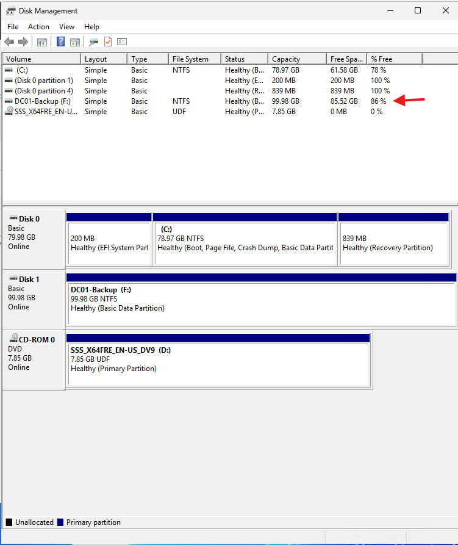
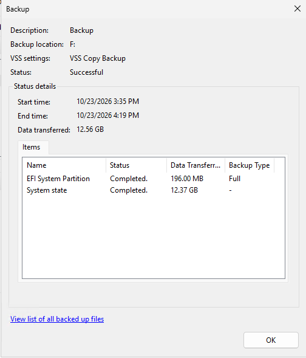
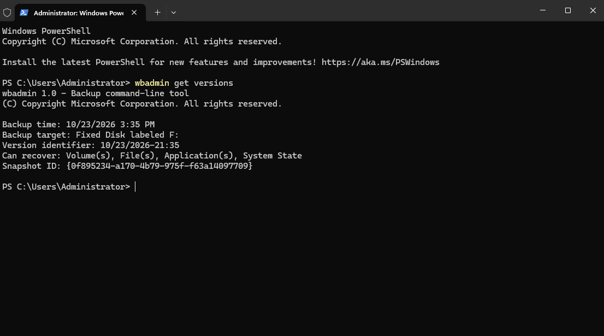

# Lab 05 - Active Directory System State Backup

## Objective
Configured dedicated backup storage for DC01, perform an Active Directory System State backup using Windows Server Backup, and verify that the backup is available for recovery.

This lab focuses on protecting critical domain controller components in the Nexora Technologies Active Directory environment.

## Lab Environment
| Component | Configuration |
| :--- | :--- |
| Server | DC01 |
| Operating System | Windows Server 2025 |
| Domain | ad.nexora.test |
| IP Address | 10.77.10.10 |
| Virtualization Platform | Hyper-V |
| Server Roles | Active Directory Domain Services, DNS |
| Backup Software | Windows Server Backup |
| Backup Type | System State |
| Backup Destination | F:\ |

## 1. Understanding Active Directory System State Backup
A Domain Controller stores critical information required for domain authentication, directory services, and centralized administration.

A System State backup protects important components needed for supported Active Directory recovery procedures.

These components include:
- Active Directory Domain Services database
- SYSVOL and Group Policy files
- Windows Registry
- Boot and system configuration components
- Other system components required by Windows Server

System State backups help administrators recover critical server configuration and directory information after certain types of failure.
A System State backup is not equivalent to a complete bare-metal recovery backup.

## 2. Installing Windows Server Backup
On DC01, installed the Windows Server Backup feature using Server Manager.

### Installation Steps
1. Opened Server Manager.
2. Selected Manage -> Add Roles and Features.
3. Selected Role-based or feature-based installation.
4. Chose DC01 as the destination server.
5. Left existing server roles unchanged.
6. Selected Windows Server Backup under Features.
7. Completed the installation wizard.
8. Verified that Windows Server Backup appeared under Server Manager -> Tools.

## 3. Creating Dedicated Backup Storage
Used Hyper-V Manager to create and attach a separate virtual hard disk for DC01 backups.

### Virtual Disk Configuration
| Setting | Value |
| :--- | :--- |
| Disk Name | DC01-Backup.vhdx |
| Format | VHDX |
| Disk Type | Dynamically Expanding |
| Maximum Capacity | 100 GB |
| Controller | SCSI |
| Virtual Machine | DC01 |

### Configuration Steps
1. Opened Hyper-V Manager on the Windows 11 host.
2. Created a new VHDX virtual hard disk.
3. Selected dynamically expanding storage.
4. Configured a maximum capacity of 100 GB.
5. Attached the disk to DC01's SCSI controller.
6. Opened Disk Management inside DC01.
7. Initialized the new disk using GPT.
8. Created a new simple volume.
9. Assigned drive letter F:.
10. Formatted the volume using NTFS.
11. Assigned the volume label DC01-Backup.

## 4. Performing the System State Backup
Opened PowerShell (Administrator) on DC01 and executed this command:
- wbadmin start systemstatebackup -backuptarget:F:

Confirmed the operation by entering Y when prompted.
Windows Server Backup began identifying and processing the files and components required for the System State backup.

The file identification process involved a large number of Windows system files.
The backup operation eventually completed successfully (Approximately an hour)

## 5. Verifying Available Backup Versions
After completing the backup, used the wbadmin command-line tool to verify that the backup was registered and available for recovery.

This confirmed that Windows Server Backup recognized an available System State recovery point.

## 6. Backup and Disaster Recovery Considerations
### Protecting Domain Controller Data
Active Directory is a critical infrastructure component.

Losing a domain controller can affect:
- User authentication
- Domain-joined computers
- DNS services
- Group policy processing
- Access to domain resources

Maintaining valid System State backups is an important part of an Active Directory disaster recovery strategy.

### Storage Limitations
The dedicated backup VHDX provides logical separation from DC01's operating system disk.

However, if the backup VHDX and DC01 are stored on the same physical Hyper-V host, a physical disk or host failure could affect both the production server and its backups.

For production environments, additional backup copies should be stored on independent, secured storage, ideally with offline or offsite protection.

### Recovery Validation
Successful backup completion and detection of a recovery version are important verification steps.

However, they do not prove that an Active Directory restore will succeed.

A full validation requires a carefully planned recovery test in an isolated environment.
Domain controller recovery should follow supported Active Directory recovery procedures rather than relying solely on Hyper-V checkpoints.

## 7. Lessons Learned
This lab provided practical experience with:
- Installing Windows Server Backup on a domain controller.
- Creating dedicated backup storage in Hyper-V.
- Initializing and formatting a GPT disk.
- Understanding Active Directory System State components.
- Using wbadmin to create a System State backup.
- Monitoring a backup containing large numbers of system files.
- Using wbadmin get versions to verify recovery points.
- Understanding the difference between backup verification and actual restore testing.
- Recognizing the need for off-host backup protection.

# References
- [Microsoft Learn - wbadmin-start-systemstatebackup](https://learn.microsoft.com/en-us/windows-server/administration/windows-commands/wbadmin-start-systemstatebackup)
- [Microsoft Learn - Windows Server Backuup Command Reference](https://learn.microsoft.com/en-us/windows-server/administration/windows-commands/windows-server-backup-command-reference)

