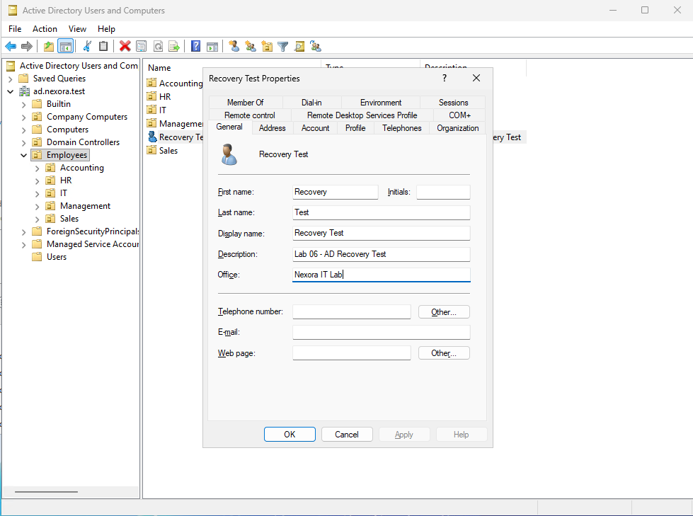
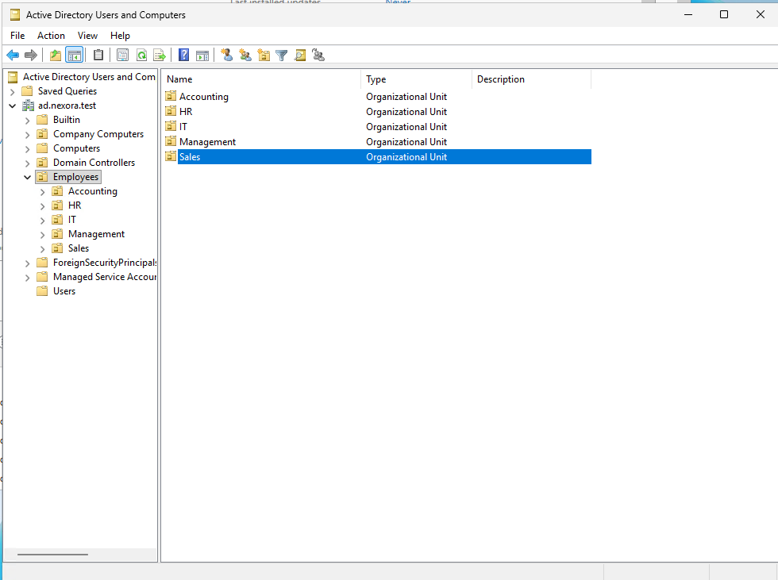
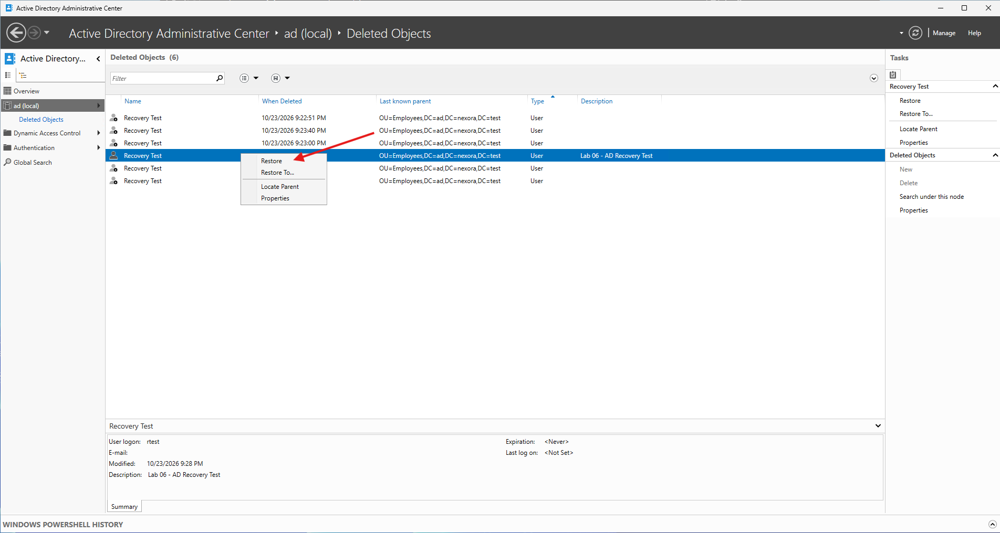
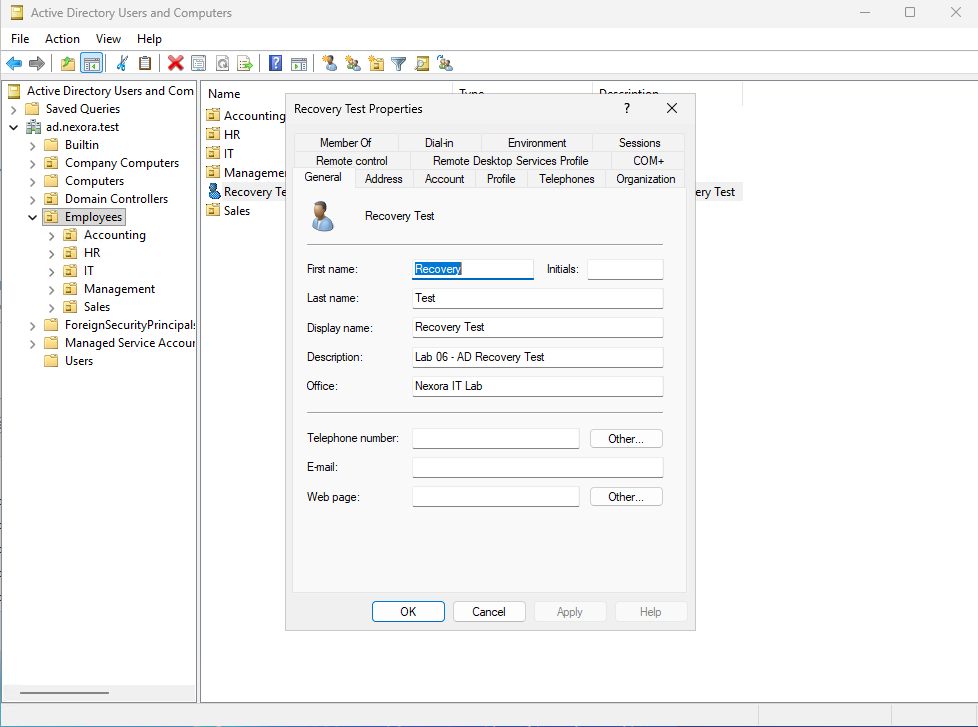

# Lab 06 - Active Directory Object Recovery

## Objective
Simulate accidental deletion of an Active Directory user account and recover it using Active Directory Recycle Bin.

This lab demonstrates how administrators can restore deleted directory objects while preserving their original attributes.

## Lab Environment
| Component | Configuration |
| :--- | :--- |
| Server | DC01 |
| Operating System | Windows Server 2025 |
| Domain | ad.nexora.test |
| IP Address | 10.77.10.10 |
| Directory Service | Active Directory Domain Services |
| Recovery Tool | Active Directory Administrative Center |
| Recovery Method | Active Directory Recycle Bin |
| Test Account | rtest |
| Organizational Unit | Employees |

## 1. Recovery Scenario
An employee account was accidentally deleted from Active Directory.

The IT administrator must recover the account while preserving its original attributes.

For this exercise, a temporary user account was created specifically for testing.

**Test account:** Recovery Test(rtest)

Existing employee accounts were not modified or deleted.

### Recovery Objectives
- Enable and verify Active Directory Recycle Bin.
- Create a temporary test user.
- Configure identifying account properties.
- Simulate accidental deletion.
- Identify the correct deleted object.
- Restore the account to its original organizational unit.
- Verify that the original attributes were preserved.

## 2. Enabling Active Directory Recycle Bin
On DC01, opened Server Manager -> Tools -> Active Directory Administrative Center
Selected the domain: ad.nexora.test

Located the Enable Recycle Bin option in the Tasks panel.

Enabled the feature and confirmed the warning that it cannot be disabled after activation.
Refreshed Active Directory Administrative Center and verified that the Deleted Objects container became available.

### Important Consideration
Active Directory Recycle Bin allows recovery of eligible objects deleted after the feature was enabled.
It does not retroactively recover objects deleted before activation.

## 3. Creating the Test Account
Opened Active Directory Users and Computers and navigated to the Employees organizational unit.

Created a temporary account with the following details:
| Property | Value |
| :--- | :--- |
| First Name | Recovery |
| Last Name | Test |
| Full Name | Recovery Test |
| Username | rtest |
| Organizational Unit | Employees |
| Description | Lab 06 - AD Recovery Test |
| Office | Nexora IT Lab |

Configured the account with a temporary password meeting the domain's password policy.
Set the account to require a password change at the next sign-in.

## 4. Simulating Accidental Account Deletion
In Active Directory Users and Computers
1. Navigated to the Employees OU.
2. Located Recovery Test (rtest).
3. Right-clicked the account and selected Delete.
4. Confirmed that the selected object was the temporary test account.
5. Approved the deletion.
6. Refreshed the Employees OU.

Verified that Recovery Test (rtest) no longer appeared in the organizational unit.

## 5. Identifying the Deleted Object
Opened Active Directory Administrative Center -> ad.nexora.test -> Deleted Objects

Multiple deleted objects with the display name Recovery Test were visible.

Because deleted objects can share display names, the correct object was identified using additional attributes.

### Identification Criteria
| Attribute | Expected Value |
| :--- | :--- |
| Display Name | Recovery Test |
| Username | rtest |
| Description | Lab 06 - AD Recovery Test |
| Deletion Time | Matched the recent test deletion |
| Original Location | Employees OU

Located the entry with the matching description, username, and deletion time.
This prevented accidentally restoring an unrelated or older deleted object.

## 6. Restoring the Deleted User

In the Deleted Objects container:
1. Selected the verified Recovery Test object.
2. Right-clicked the object.
3. Selected Restore
4. Refreshed Active Directory Administrative Center.
5. Opened Active Directory Users and Computers.
6. Navigated to the Employees OU.
7. Confirmed that Recovery Test(rtest) had reappeared.

The Restore action returned the account to its original organizational unit.

## 7. Recovery Methods and Limitations
Active Directory Recycle Bin provides a convenient method for recovering eligible deleted directory objects.

It is particularly useful when an administrator accidentally deletes a user, group, computer account, or organizational unit.
The feature can preserve important object attributes during the deleted-object recovery period.

## Limitations
This exercise successfully verified recovery of one Active Directory user account.

It did not test:
- Full domain controller restoration.
- Active Directory authoritative restore.
- Forest recovery.
- Restoration from the System State backup.
- Recovery of deleted objects beyond their eligible recovery period.

These scenarios require additional planning and supported recovery procedures.

## 8. Lessons Learned
This lab provided practical experience with:
- Enabling Active Directory Recycle Bin.
- Understanding deleted-object recovery.
- Creating test accounts for controlled recovery exercises.
- Identifying deleted accounts using multiple attributes.
- Restoring deleted objects to their original organizational units.
- Verifying that recovered directory attributes were preserved.
- Understanding the distinction between Recycle Bin recovery and System State restoration.
- Documenting recovery procedures and collecting evidence.
