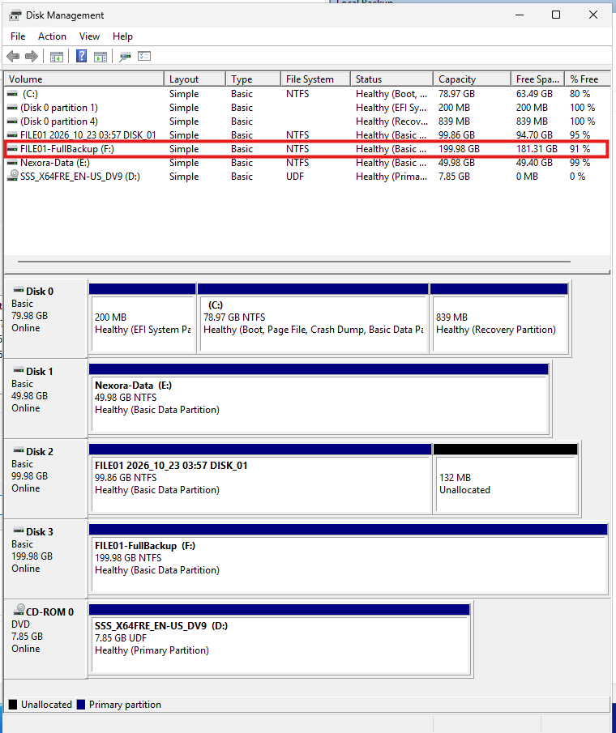
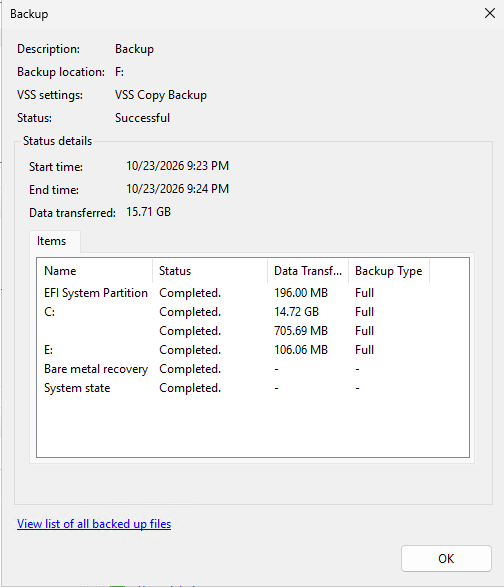
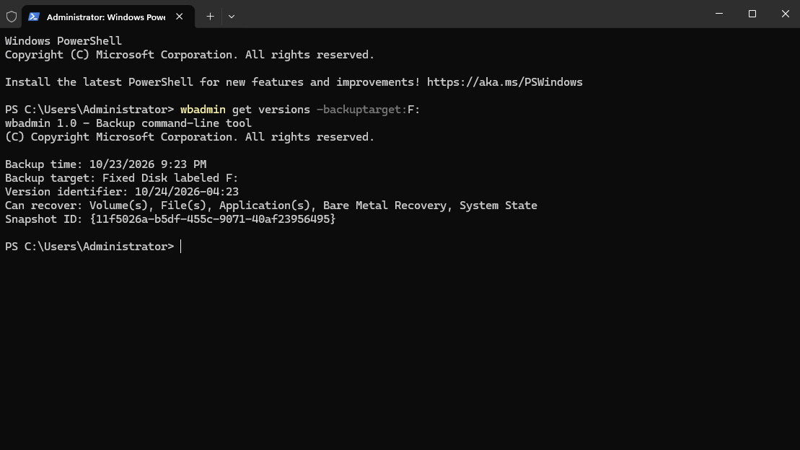

# Lab 07 - Full Server Backup Configuration

## Objective
Configure and perform a backup of FILE01 that supports Bare Metal Recovery using Windows Server Backup.

This lab demonstrates how to protect the Windows Server operating system, critical system components, and departmental data while preserving an existing scheduled file backup.

## Lab Environment
| Component | Configuration |
| :--- | :--- |
| Server | FILE01 |
| Operating System | Windows Server 2025 |
| Domain | ad.nexora.test |
| IP Address | 10.77.10.30 |
| Virtualization Platform | Microsoft Hyper-V |
| Backup Software | Windows Server Backup |
| Backup Configuration | Custom |
| Recovery Capability | Bare Metal Recovery |
| Backup Destination | F:\ |
| Backup Destination Size | 200 GB |

## 1. Understanding Full Server Backup
A full server backup protects the operating system and the data required to recover a Windows Server installation.

This lab includes the critical system components required for Bare Metal Recovery.

### Recovery Components
The backup selection included:
- Windows Server operating system colum (C:)
- EFI System Partition
- Required system and recovery partitions
- System State
- Bare Metal Recovery components
- Departmental data stored on E:

Bare Metal Recovery is designed to restore a Windows installation after serious system failure.

## 2. Creating a Dedicated Full Backup Disk
Created an additional virtual hard disk through Hyper-V Manager.

### Virtual Disk Configuration
| Setting | Configuration |
| :--- | :--- |
| Disk Name | FILE01.FullBackup.vhdx |
| Disk Format | VHDX |
| Disk Type | Dynamically Expanding |
| Maximum Capacity | 200 GB |
| Controller | SCSI |
| Virtual Machine | FILE01 |

### Configuration Steps
1. Opened Hyper-V Manager on the Windows 11 host.
2. Launched the New Virtual Hard Disk Wizard.
3. Selected VHDX.
4. Selected Dynamically Expanding.
5. Named the disk FILE01-FullBackup.vhdx.
6. Configured a maximum size of 200 GB.
7. Created the new blank virtual disk.
8. Attached it to FILE01 through the SCSI controller.

The new disk was added without removing or modifying FILE01's existing disks.

## 3. Initializing and Formatting the Backup Volume
on FILE01, opened Windows Disk Management.

### Configuration Steps
1. Located the newly attached 200 GB disk.
2. Initialized the disk using GPT.
3. Created a new simple volume.
4. Assigned drive letter F:.
5. Formatted the volume using NTFS.
6. Assigned the volume label FILE01-FullBackup.

## 4. Configuring the Backup
Opened Server Manager -> Tools -> Windows Server Backup -> Local Backup -> Backup Once

Selected Different options to create a one-time backup independently of the existing scheduled departmental backup.

### Custom Backup Configuration
Used Add Items to select the components required for recovery.

| Component | Selection |
| :--- | :--- |
| Bare Metal Recovery | Included |
| Operating System (C:) | Included |
| EFI System Partition | Included |
| Required system partitions | Included |
| System State | Included |
| Departmental data (E:) | Included |
| Existing 100 GB backup disk | Excluded |
| New 200 GB backup destination (F:) | Excluded |

The existing departmental backup disk was explicitly excluded to prevent copying backup data into the new backup.
The new destination volume was also excluded from the source selection.

## 5. Selecting the Backup Destination
On The Specify Destination Type screen:
1. Selected Local drives.
2. Chose the new F: backup volume.
3. Reviewed the selected backup items.
4. Confirmed that the previous 100 GB backup disk was excluded.
5. Confirmed that the destination volume was not included among the backup sources.

### Final Backup Configuration
| Setting | Configuration |
| :--- | :--- |
| Backup Type | One-time |
| Backup Configuration | Custom |
| Recovery Capability | Bare Metal Recovery |
| Data Protection | System components and departmental data |
| Backup Destination | F: |
| Existing Daily Backup Schedule | Preserved |

## 6. Executing the Backup
After verifying the configuration, started the backup using the Windows Server Backup Wizard.

Windows Server Backup processed the selected operating system and data components.
The backup operation completed successfully.

## 7. Verifying Bare Metal Recovery Capability
After the backup completed, opened Command Prompt (Administrator) and executed this script:
- wbadmin get versions -backuptarget:F:

The command displayed a backup version and confirmed that Bare Metal Recovery was available.

## 8. Backup and Recovery Considerations
### Bare Metal Recovery
Bare Metal Recovery is designed to restore a Windows Server installation after major operating system or storage failure.

It requires a backup containing the critical volumes necessary to recover the Windows installation.
The recovery process may involve booting into Windows Recovery Environment and selecting a suitable system image backup.

### Preserving Existing Backups
FILE01's daily departmental backup was not replaced by the one-time backup configuration.

The two backup configurations serve different purposes:
- Daily departmental backup: Regular protection of E:\Departments.
- Bare-metal-capable backup: Recovery of critical Windows Server components and departmental data after a larger failure.

### Storage Limitations
The 200 GB backup destination is logically separate from FILE01's operating system and departmental data disks.

However, the virtual disks share the same physical Hyper-V host.

This does not provide protection against complete physical host failure or underlying storage failure.

A production disaster recovery plan should use independent backup storage, offsite or offline copies, and regular recovery testing.

### Recovery Validation
The completed backup and the wbadmin output confirm that a recovery point supporting Bare Metal Recovery is available.

However, these checks do not prove that an entire server can be successfully restored.

An isolated restoration test is required to validate full recoverability.

## 9. Lessons Learned
This lab provided practical experience with:
- Planning full server backup storage requirements.
- Creating and attaching VHDX disks in Hyper-V.
- Configuring GPT and NTFS volumes.
- Distinguishing Full server and Custom backup configurations.
- Selecting Bare Metal Recovery components.
- Excluding backup destinations from backup sources.
- Preserving existing scheduled backup configurations.
- Executing one-time Windows Server backups.
- Verifying recovery points using wbadmin.
- Understanding the difference between backup completion and successful disaster recovery.
