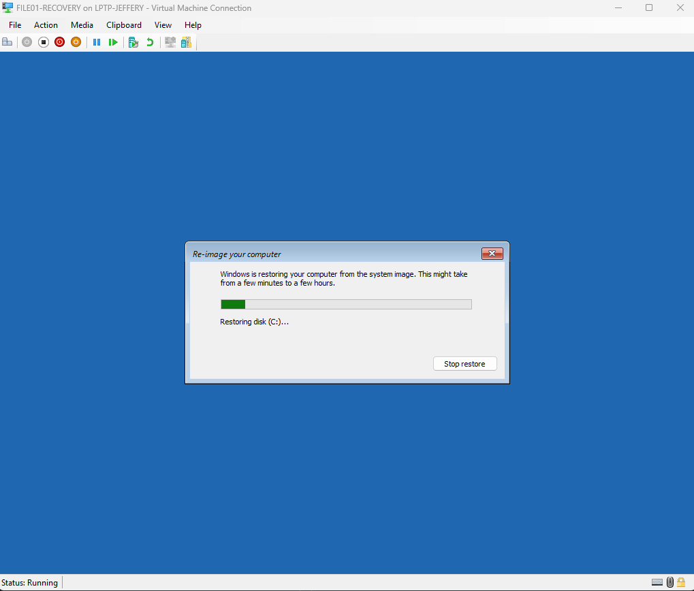
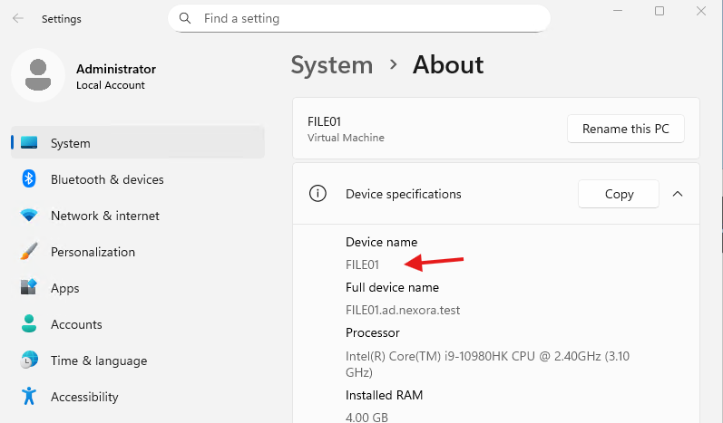
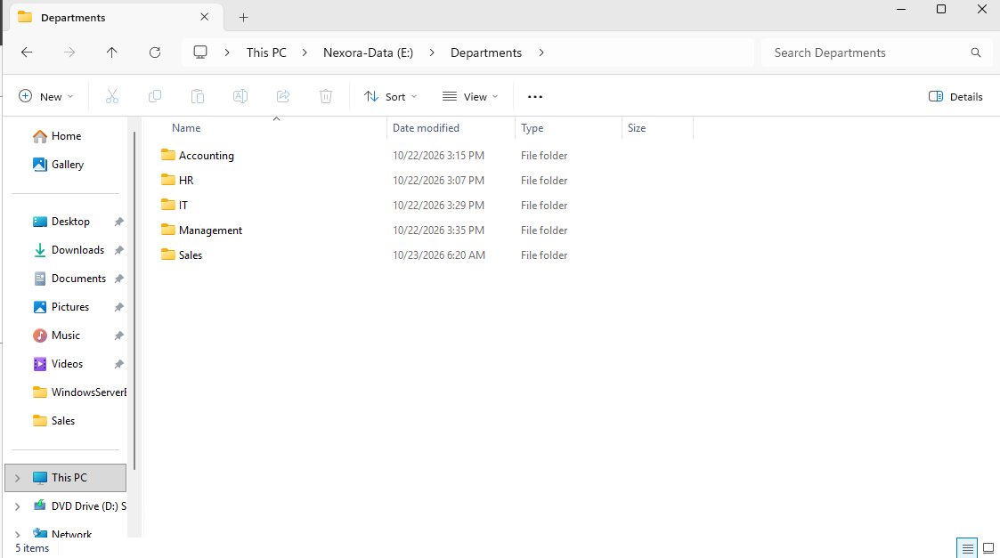
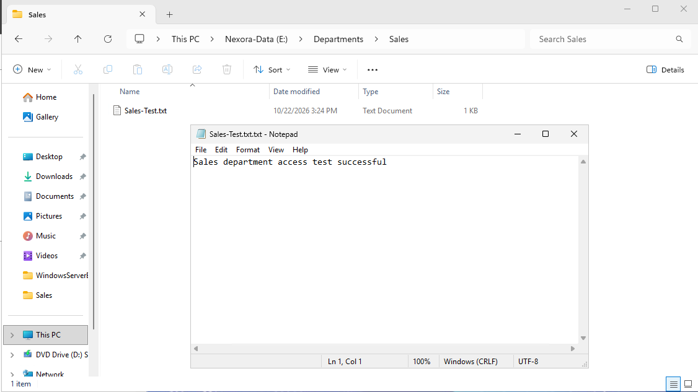

# Lab 08 - Disaster Recovery Simulation

## Objective
Simulate a major Windows Server failure and validate Bare Metal Recovery by restoring FILE01 into a separate, isolated Hyper-V virtual machine.

This lab tests whether the backup created in Lab 07 can restore a bootable Windows Server installation and recover departmental data without overwriting the original server.

## Lab Environment
| Component | Configuration |
| :--- | :--- |
| Original Server | FILE01 |
| Operating System | Windows Server 2025 |
| Domain | ad.nexora.test |
| Original IP Address | 10.77.10.30 |
| Virtualization Platform | Microsoft Hyper-V |
| Recovery Virtual Machine | FILE01-RECOVERY |
| Recovery Network | Recovery-Isolated |
| Recovery Method | Bare Metal Recovery |
| Backup Source | Lab 07 full server backup |
| Backup Date | October 23, 2026, 08:23:20 PM |

## 1. Disaster Recovery Scenario
FILE01 is a departmental file server used by the Nexora Technologies.

It provides departmental storage for:
- Human resources
- Accounting
- Sales
- Information Technology
- Management

### Simulated Incident
The original FILE01 server is assumed to have experience a major operating system or storage failure, making a complete restoration necessary.

Instead of destroying or modifying the working server, this exercise uses a separate recovery virtual machine.

### Recovery Objectives
1. Preserve the original FILE01 server.
2. Create an isolated recovery environment.
3. Locate a valid system image backup.
4. Restore Windows Server using Bare Metal Recovery.
5. Verify that the restored operating system boots.
6. Verify that the recovered server retains its original computer identity.
7. Restore and access the departmental data volume.
8. Confirm that recovered files are readable.

## 2. Preparing the Recovery Environment
Created a new private virtual switch in Hyper-V Manager.

### Virtual Switch Configuration
| Setting | Value |
| :--- | :--- |
| Switch Name | Recovery-Isolated |
| Switch Type | Private |
| Purpose | Isolated disaster recovery testing |

The Private virtual switch separates the recovery VM from the existing Nexora Technologies lab network.

This is important because the recovered server retains the original FILE01 computer name and domain configuration.
Connecting both servers to the same network could introduce duplicate computer identities and other conflicts.

The existing Nexora-Internal virtual switch was left unchanged.

## 3. Creating the Recovery Virtual Machine
Created a separate virtual machine using Hyper-V Manager.

### Recovery VM Configuration
| Setting | Value |
| :--- | :--- |
| Virtual Machine Name | FILE01-RECOVERY |
| Generation | 2 |
| Startup Memory | 4096 MB |
| Dynamic Memory | Disabled |
| Network | Recovery-Isolated |
| Operating System Installation | Install later |

### Recovery Virtual Disks
Created two new virtual hard disks for the restoration.

| Virtual Disk | Capacity | Purpose |
| :--- | :--- | :--- |
| FILE01-RECOVERY-OS.vhdx | 100 GB | Operating system recovery |
| FILE01-RECOVERY-DATA.vhdx | 60 GB | Departmental data recovery |

Both disks were created independently of the original FILE01 virtual disks.

No original operating system or departmental data VHDX was reused as a recovery destination.

## 4. Preparing an Independent Backup Copy
The original FILE01 full server backup was stored in:

FILE01-FullBackup.vhdx

To prevent interference with the existing backup configuration, shut down the original FILE01 normally and created a separate copy of the backup VHDX.

### Backup Copy
| File | Purpose |
| :--- | :--- |
| FILE01-FullBackup.vhdx | Original full server backup |
| FILE01-RecoveryBackup.vhdx | Independent backup copy for recovery testing |

Attached the copied backup VHDX to FILE01-RECOVERY.

### Final Recovery VM Storage
| Disk | Capacity | Purpose |
| Disk 0 | 100 GB | Recovery operating system |
| Disk 1 | 60 GB | Recovery departmental data |
| Disk 2 | 200 GB | Copied backup source |

The original FILE01 virtual disks remained unchanged.

## 5. Booting into Windows Recovery Environment
Attached a Windows Server 2025 installation ISO to the recovery VM.
Configured the virtual machine's firmware to boot from the DVD drive.

### Recovery Procedure
1. Started FILE01-RECOVERY.
2. Booted from the Windows Server 2025 ISO.
3. Selected the Windows repair option instead of installing a new operating system.
4. Opened Troubleshoot -> Advanced options -> System Image Recovery.
5. Located the available system image backup.

This allowed the recovery process to use the existing FILE01 system image.

## 6. Identifying the Backup Image
Windows Recovery Environment detected the following image:

| Property | Detected Value |
| :--- | :--- |
| Computer | FILE01 |
| Backup Date | October 23,2026 |
| Backup Time | 08:23:20 PM |
| Backup Volume Label | FILE01-FullBackup |

The recovery environment displayed the backup location using drive C.

Drive letters assigned in Windows Recovery Environment can differ from the letters assigned by the installed operating system.
The backup was verified using its computer name, date, time, and volume label.

## 7. Reviewing Disk Safety Before Recovery
Before starting the recovery, reviewed the restore configuration.

The image contained the following components:
- EFI System Partition
- Windows Server operating system volume
- Additional system volume
- Departmental data volume
- Required components for Bare Metal Recovery

### Disk Exclusion Review
The Recovery Wizard listed the 100 GB and 60 GB recovery destination disks as available for repartitioning.

The 200 GB disk containing the selected backup was not presented as a recovery destination in the Exclude Disks dialog.

### Disk Verification
Using Command Prompt in Windows Recovery Environment to inspect the attached disks (Shift + F10)
- list disk

The command identified:
| Disk | Capacity | Purpose |
| :--- | :--- | :--- |
| Disk 0 | 100 GB | Recovery OS |
| Disk 1 | 60 GB | Recovery data |
| Disk 2 | 200 GB | Backup source |

Inspected Disk 2 with:
- select disk 2
- detail disk

Confirmed that Disk 2 contained the volume labeled FILE01-FullBackup.

This step helped verify the identify of the backup source before beginning a destructive disk restoration operation.

## 8. Performing Bare Metal Recovery
After reviewing the backup selection and disk configuration, started the Bare Metal Recovery operation.

Windows Recovery Environment restored the selected image onto the recovery virtual machine.
The process restored the Windows Server installation and its protected system components.

After completion, the recovery environment prompted for a restart.
Restarted FILE01-RECOVERY and allowed Windows Server to boot from the restored virtual disk.

After the recovery VM booted, verified the restored computer identity, departmental folders.

## 9. Recovery Considerations and Limitations
### Recovery Point Objective
The backup used for this test was created on October 23, 2026 at 08:23:20 PM.

Recovery restored the protected data to the state captured by that backup.
Changes made after the backup's recovery point would not necessarily be recovered.

### Recovery Time Objective
This lab demonstrated that restoration was technically possible.

However, an accurate recovery time was not measured or recorded.

A production recovery plan should measure the complete recovery process, including restoration, validation, and return to service.

### Network Isolation
The recovery virtual machine remained connected to the Recovery-Isolated private virtual switch.

This prevented the restored FILE01 from being introduced into the existing domain network during testing.

### Backup Storage Limitations
The full server backup and recovery environment were hosted on the same physical Hyper-V system.

Although the recovery used separate virtual disks, this setup would not protect against a complete failure of the underlying physical host or storage.

## 10. Lessons Learned
This lab provided practical experience with:
- Designing an isolated disaster recovery environment.
- Creating private virtual switches in Hyper-V.
- Preparing new operating system and data recovery disks.
- Creating independent copies of backup VHDX files.
- Booting Windows Server into Windows Recovery Environment.
- Locating and identifying system image backups.
- Inspecting recovery disks using DiskPart.
- Understanding disk exclusion and repartitioning risks.
- Performing Bare Metal Recovery.
- Troubleshooting offline disks after restoration.
- Verifying restored operating system identity.
- Confirming departmental folders and files are recoverable.
- Understanding the difference between a successful backup and a tested restoration.

