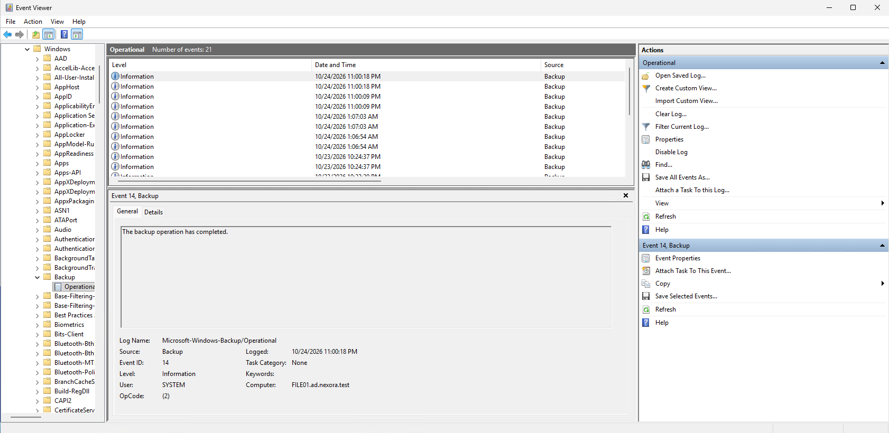
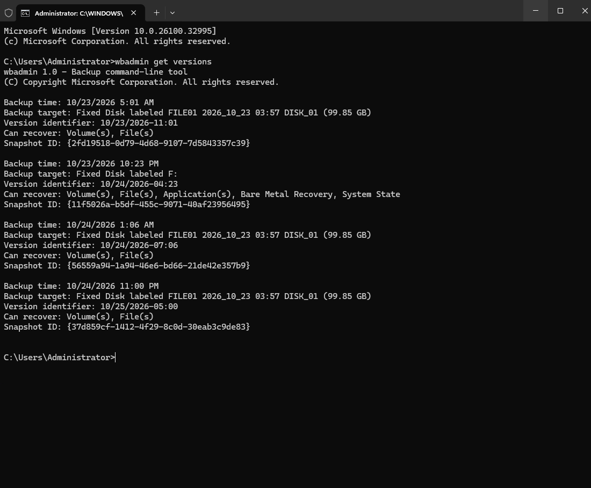
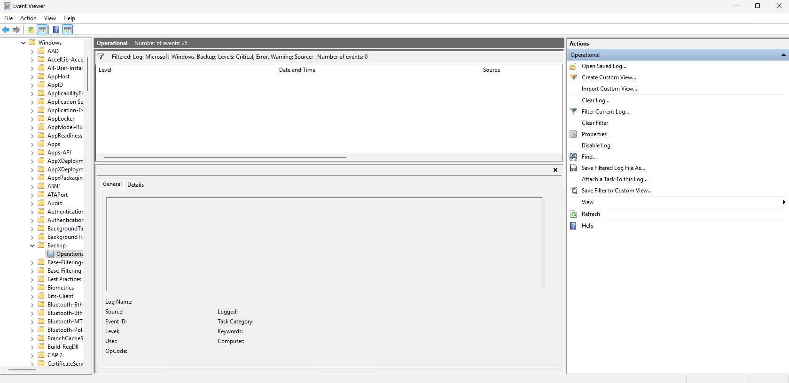

# Lab 09 - Backup Verification and Monitoring

## Objective
Verify Windows Server Backup recovery points, review backup events, identify potential failures, and establish a routine backup monitoring checklist for Nexora Technologies.

This lab demonstrates how administrators can monitor the health of their backup environment rather than relying on successful backup information.

## Lab Environment
| Component | Configuration |
| :--- | :--- |
| Server | FILE01 |
| Operating System | Windows Server 2025 |
| Domain | ad.nexora.test |
| IP Address | 10.77.10.30 |
| Backup Software | Windows Server Backup |
| Event Monitoring | Windows Event Viewer |
| Command-Line Utility | wbadmin |
| Departmental Backup Schedule | Daily at 11:00 PM |
| Recovery Methods | File, Volume, and Bare Metal Memory |

## 1. Backup Monitoring Overview
Backups are essential for protecting data from accidental deletion, system failures, and other disruptive incidents.

However, creating a backup schedule alone does not guarantee reliable protection.

IT administrators must regularly verify that backups are running, review error messages, monitor storage capacity, and periodically test recovery procedures.

## Monitoring Objectives
- Confirm that scheduled backups remain configured.
- Review recent backup results.
- Identify backup warnings and errors.
- Verify available backup recovery points.
- Understand supported recovery methods.
- Create a repeatable monitoring checklist.

## 2. Reviewing Windows Server Backup Status
On FILE01, opened:

Server Manager -> Tools -> Windows Server Backup -> Local Backup

Reviewed the following sections:
| Section | Purpose |
| :--- | :--- |
| Messages | Displays backup-related notifications |
| Status | Displays information about recent backup operations |
| Scheduled Backup | Shows the configured automatic backup schedule |

Confirmed that the scheduled departmental backup remained configured for 11:00 PM daily.

The configuration established in Lab 03 remained available after the full server backup and disaster recovery exercises.

## 3. Event Log Review
Opened Windows Event Viewer and navigated to:

Applications and Services Logs -> Microsoft -> Windows -> Backup -> Operational

Selected an event and it indicated that Windows Server Backup had recorded the completion of a backup operation.
Event messages should be interpreted alongside the corresponding backup status and recovery point details because an informational completion event alone does not prove full recoverability.

## 4. Reviewing Backup History with wbadmin
Opened Command Prompt (Administrator) on FILE01 and executed this command:
- wbadmin get version

This command lists registered Windows Server Backup recovery points and their supported recovery.

### Recovery Point Analysis
The results showed three recovery points associated with FILE01's departmental backup storage.

These recovery points supported file-level and volume-level recovery.

A separate recovery point on the 200 GB full backup volume supported additional recovery capabilities, including:
- Application recovery
- Bare Metal recovery
- System State recovery

## 5. Checking for Backup Warnings and Errors
Opened Windows Event Viewer and navigated to:

Applications and Services Logs -> Microsoft -> Windows -> Backup -> Operational

Selected Filter Current Log and configured the filter to display only:
- Critical
- Error
- Warning

Excluded Information events.

### Monitoring Result
The filtered event list was empty.

No matching Critical, Error, or Warning events were found in the currently retained Backup Operational log.

### Interpretation

An empty filtered event log is encouraging but does not guarantee that every backup succeeded.

Administrators should also verify job completion, backup recency, available recovery points, and the results of periodic recovery tests.

## 6. Backup Monitoring Checklist
Established the following proposed monitoring procedure for Nexora Technologies.

### Daily Monitoring
- Confirm that the most recent scheduled backup ran at the expected time.
- Check whether the backup completed successfully.
- Review new Warning, Error, and Critical events.
- Investigate unexpected gaps in the backup schedule.
- Record any failed backup jobs and corrective actions.

### Weekly Monitoring
- Run wbadmin get versions to verify available recovery points.
- Confirm that backups are stored on the intended destination.
- Review the amount of free backup storage.
- Confirm that backup schedules remain enabled.
- Review unresolved backup-related warnings or errors.

### Monthly Monitoring
- Perform a controlled file recovery test.
- Verify that recovered data can be opened.
- Review backup retention requirements.
- Inspect backup destination permissions and access controls.
- Review offsite or offline backup protection.
- Update backup and recovery documentation.

### Periodic Disaster Recovery Testing
- Test recovery in an isolated environment.
- Verify that restored systems boot successfully.
- Confirm that important applications and data remain accessible.
- Measure and document recovery duration.
- Review recovery point and recovery time objectives.
- Document lessons learned and corrective actions.

These are recommended monitoring activities for the homelab.

## 7. Example Backup Monitoring Procedure
An administrator beginning a daily backup review should:
1. Sign in to FILE01.
2. Open Windows Server Backup.
3. Review the latest backup status.
4. Confirm that the backup was performed within the expected time window.
5. Open Event Viewer.
6. Review relevant Backup Operational events.
7. Investigate any warnings or errors.
8. Confirm that appropriate recovery points remain available.
9. Document any issues and corrective actions.

If a backup fails, the administrator should determine the cause, correct the issue, rerun the backup if appropriate, and verify the resulting recovery point.

## 8. Lessons Learned
This lab provided practical experience with:
- Reviewing Windows Server Backup status.
- Confirming scheduled backup configuration.
- Navigating Windows Event Viewer.
- Interpreting backup-related Event IDs.
- Filtering logs for warnings and errors.
- Listing backup recovery points using wbadmin.
- Comparing different backup recovery capabilities.
- Understanding why backup recency matters.
- Developing recurring operational monitoring procedures.
- Distinguishing backup availability from verified recoverability.

