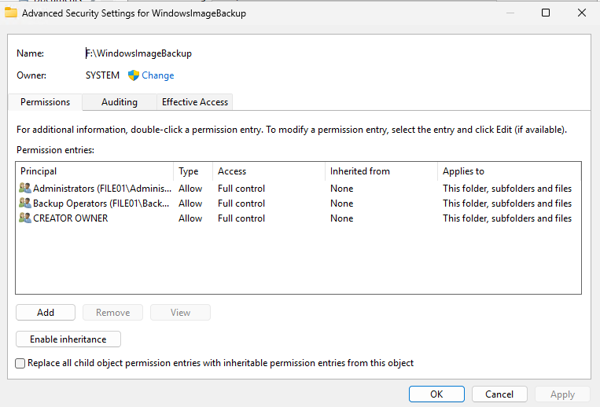
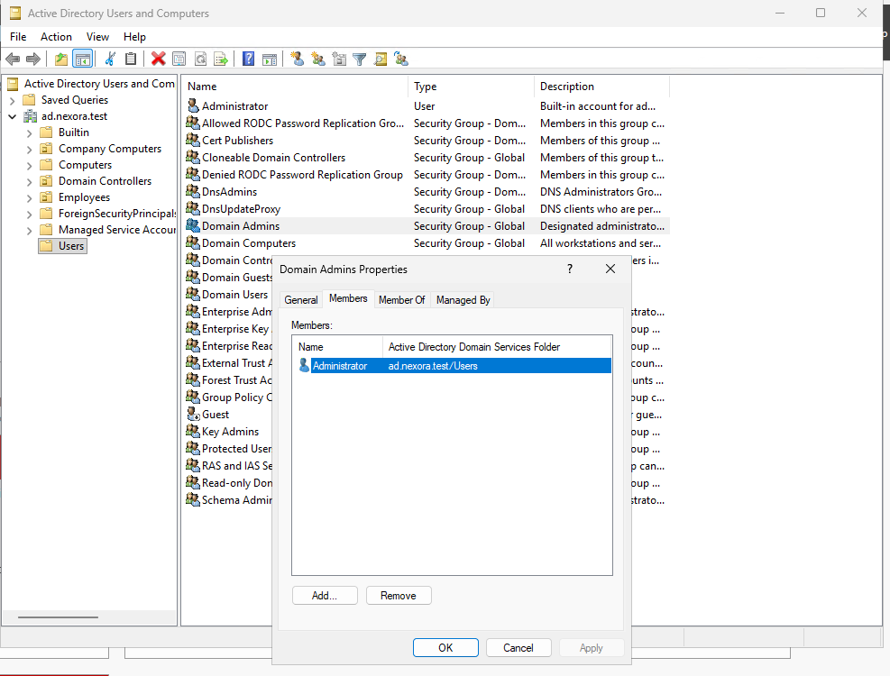
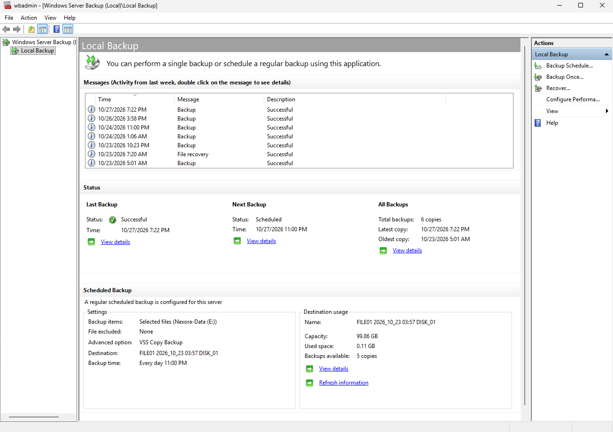

# Lab 10 - Security Review

## Objective
Evaluate the security of the Nexora Technologies Windows Server backup infrastructure by reviewing backup storage permissions, privileged administrative access, storage capacity, and potential security risks.

The review focuses on identifying existing safeguards, security weaknesses, and recommended improvements.

## Lab Environment
| Component | Configuration |
| :--- | :--- |
| Domain | ad.nexora.test |
| Domain Controller | DC01 |
| File Server | FILE01 |
| Operating System | Windows Server 2025 |
| Virtualization | Microsoft Hyper-V |
| Backup Software | Windows Server Backup |
| Daily Backup Disk | Dedicated 100 GB VHDX |
| Full Server Backup | 200 GB NTFS volume (F:) |

## 1. Backup Volume Security Review
On FILE01, opened File Explorer and navigated to:

F:\ -> Properties -> Security -> Advanced

Reviewed the NTFS permissions assigned to the backup storage volume.

### Security Principals
- Everyone
- CREATOR OWNER
- SYSTEM
- Administrators
- Users

### Everyone Permissions
| Permission | Applies To |
| :--- | :--- |
| Read & execute | This folder only |
| List folder contents | This folder only |
| Read | This folder only |

Everyone entry did not grant Modify or Full Control. However, it is a broad security principal, so unnecessary access should be limited.

### Users Permissions
| Permission | Applies To |
| :--- | :--- |
| Read & execute | This folder, subfolders, and files |
| Create folders / append data | This folder and subfolders |
| Create files / write data | Subfolders only |
| Read & execute | This folder only |

**Finding**: The Users group has write-related permissions in certain locations on the backup volume. These entries warrant further review, although they do not establish that users can modify or delete the actual backup files.

**Recommendation**: Review effective permissions and restrict unnecessary write access without disrupting Windows Server Backup.

## 2. WindowsImageBackup Folder Security
Inspected the permissions for:

F:\WindowsImageBackup

Opened Properties -> Security -> Advanced

Administrators and Backup Operators had Full Control applying to This folder, subfolders, and files.

### Security Assessment
The absence of direct Everyone and Users entries is a positive finding.

However, Full Control allows privileged accounts to manage, modify, and potentially delete backups.

**Recommendation**: Restrict privileged access, regularly review effective permissions, and maintain protected backup copies outside the server.

## 3. Privileged Group Membership Review
On DC01, opened:

Active Directory Users and Computers
Reviewed privileged Active Directory groups and their direct memberships.

### Membership Results
| Group | Members |
| :--- | :--- |
| Built-in Backup Operators | None |
| Built-in Administrators | Administrator, Domain Admins, Enterprise Admins |
| Domain Admins | Administrator |
| Enterprise Admins | Administrator |

### Security Assessment
No additional employee accounts were directly listed in the reviewed administrative groups.
The limited membership reduces unnecessary exposure to highly privileged roles.

However, the built-in Administrator account remains highly privileged. Nested memberships and other effective administrative access paths were not exhaustively audited.

### Recommendations
- Maintain least-privileged administrative access.
- Use separate standard and administrative accounts.
- Protect privileged accounts with strong authentication.
- Review direct and nested group memberships regularly.
- Audit administrative sign-ins and changes.

## 4. Full Server Backup Storage Capacity
Reviewed the properties of F:

### Storage Results
| Metric | Value |
| :--- | :--- |
| Total Capacity | 199 GB |
| Used Space | 18.6 GB |
| Free Space | 181 GB |

### Assessment
The backup volume currently has substantial available storage. However, future backup requirements may increase with operating system updates, applications, and departmental data growth.

**Recommendation**: Monitor storage utilization and establish appropriate backup retention and capacity thresholds.

## 5. Scheduled Backup Destination Review
On FILE01, opened:

Windows Server Backup -> Local Backup -> Scheduled Backup -> Destination Usage

### Destination Information
| Metric | Value |
| :--- | :--- |
| Backup Disk | FILE01 2026_10_23 03:57 DISK_01 |
| Capacity | 99.86 GB |
| Used Space | 0.11 GB |
| Available Copies | 5 |
| Scheduled Backup | Daily at 11:00 PM |

### Assessment
Windows Server Backup reports 5 available recovery copies on the departmental backup disk.

The reported used-space figure should not be interpreted alone as the total physical size of all backup data.

**Recommendation**: Regularly review backup availability, backup retention, and storage health.

## 6. Identified Security Risks
| Risk ID | Security Risk | Priority |
| :--- | :--- | :--- |
| R-01 | Backup disks share the same physical Hyper-V host | High |
| R-02 | Privileged accounts have extensive backup access | High |
| R-03 | Users have some write-related permissions on the backup volume | Medium |
| R-04 | Backup monitoring relies on manual review | Medium |
| R-05 | Future backup storage growth may reduce available capacity | Medium |
| R-06 | Domain controller System State restoration has not been tested | Medium |

### R-01 Shared Physical Storage
All virtual disks reside on the same physical Hyper-V host.

A hardware failure or compromise affecting the host could make both the production systems and their backups unavailable.

**Recommendation**: Maintain independent off-host, offline, or appropriately immutable backup copies.

### R-02 Privileged Backup Access
Administrators and Backup Operators have Full Control over the WindowsImageBackup folder.

A compromised privileged account could potentially modify or remove backup data.

**Recommendation**: Apply least privileged, monitor privileged activity, and isolate protected backup copies.

### R-03 Broad Volume Permissions
The Users group has permissions to create files or folders in certain locations on the F: volume.

**Recommendation**: Review effective access and remove unnecessary permissions where safe.

### R-04 Manual Backup Monitoring
Backup status and errors are currently reviewed through Windows Server Backup, Event Viewer, and wbadmin.

**Recommendation**: Implement centralized monitoring and automatic notifications for missed or failed backups.

### R-05 Storage Capacity Growth
The backup disks currently have available capacity, but future data growth could affect retention.

**Recommendation**: Define capacity thresholds and review backup storage regularly.

### R-06 Untested Domain Controller Restoration
DC01 has a verified System State backup, but an actual System State restoration has not been performed.

**Recommendation**: Plan a supported Active Directory recovery exercise in a properly isolated environment.

